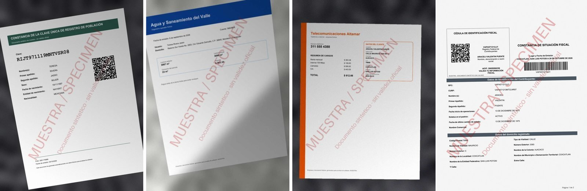

# extraccion-documentos-mx

Extracción automática de datos de documentos oficiales mexicanos (CURP, INE, Constancia de Situación Fiscal y comprobante de domicilio) para prellenar un formulario de alta. La persona sube sus documentos; el sistema extrae, valida y prellena los campos, y la persona solo revisa y confirma.

> **Este repositorio usa solo datos sintéticos.** No contiene ni acepta documentos reales: un hook de pre-commit y la CI bloquean cualquier PDF o imagen fuera de `data/synthetic/` y `docs/img/`, aunque se le cambie la extensión.

## Estado

En desarrollo, en la **fase 6 de 9**. Ya están:

- el esqueleto del repo, las herramientas, la CI y los esquemas de salida (fase 1);
- los validadores y la normalización (fase 2): CURP y RFC con dígito verificador, nombres entre documentos, domicilio contra el catálogo de SEPOMEX y antigüedad del comprobante. Las reglas, sus fuentes y lo que no se pudo verificar están en [docs/validaciones.md](docs/validaciones.md);
- el generador de datos sintéticos (fase 3): personas ficticias con sus 4 documentos, en PDF digital, escaneo y foto de celular, con su ground truth. Hay un diseño de comprobante reservado para test. Detalles en [synth/README.md](synth/README.md);
- la ruta de texto (fase 4): router (texto vs. imagen), clasificador de palabras clave y parsers sobre la capa de texto del PDF, sin ML. Incluye `make eval` y `eval_private.py` para medir con documentos reales sin exponer sus datos (ver [eval/README.md](eval/README.md));
- el extractor A y el primer modelo entrenado (fase 5):
  - **OCR + reglas:** Tesseract en español con preprocesamiento en OpenCV (contorno de la hoja, perspectiva, inclinación e iluminación). Lo leído pasa por los mismos parsers que la capa de texto, ahora también para INE y comprobante;
  - **CURP y RFC corregidos** por su estructura y su dígito verificador, y el **código postal** con SEPOMEX y el municipio impreso;
  - **clasificador de documentos** TF-IDF + regresión logística, comparado con el de palabras clave en [reports/clasificador.md](reports/clasificador.md);
- los extractores B y C1 en Amazon Bedrock (fase 6), comparados con A sobre los mismos escaneos y fotos, con costo real por documento:
  - **B, OCR + LLM:** el texto del OCR va a un LLM (Amazon Nova);
  - **C1, visión:** un modelo multimodal lee la imagen (Amazon Nova o Qwen3-VL);
  - en los dos, la respuesta tiene esquema fijo, se valida con pydantic y pasa por los mismos validadores que las reglas. Hay un tope de gasto y solo se envían datos sintéticos.



## Resultados

Generados por `make eval` y `make train-clasificador` sobre el split test del dataset sintético (75 personas, 300 documentos). El detalle está en [reports/resultados.md](reports/resultados.md) y [reports/clasificador.md](reports/clasificador.md).

**Documentos con todos los campos correctos** (entre paréntesis, cuántos hay en test):

| Documento | Digital (capa de texto) | Escaneo (OCR) | Foto de celular (OCR) |
|---|---:|---:|---:|
| CURP | 100.0% (48) | 86.4% (22) | 60.0% (5) |
| CSF | 100.0% (53) | 77.8% (18) | 25.0% (4) |
| INE | 100.0% (3) | 81.5% (27) | 26.7% (45) |
| Comprobante de domicilio | 100.0% (27) | 60.0% (15) | 33.3% (33) |
| Comprobante, diseño no visto en train | 100.0% (14) | 57.1% (7) | 15.4% (13) |

Latencia p50: de 32 a 364 ms por la capa de texto; de 2.4 a 6.8 s por OCR. Costo: $0.

**Clasificador de documentos** (exactitud; "no reconocido" cuenta como error):

| Texto | Documentos | Palabras clave | TF-IDF + regresión logística |
|---|---:|---:|---:|
| Todos | 300 | 84.0% | 98.3% |
| Capa de texto del PDF | 131 | 89.3% | 100.0% |
| OCR de escaneos y fotos | 169 | 79.9% | 97.0% |
| Comprobante de diseño no visto en train | 34 | 0.0% | 94.1% |

El router (texto vs. imagen) acierta en los 300.

**Extractores de imagen comparados** (`make eval-llm`, los mismos 169 escaneos y fotos de test; detalle en [reports/comparacion.md](reports/comparacion.md)). Los modelos se eligieron en val ([reports/comparacion_val.md](reports/comparacion_val.md)):

| Extractor | Documentos 100% correctos | Campos correctos | Latencia p50 | Costo por documento |
|---|---:|---:|---:|---:|
| A: OCR + reglas | 53.8% | 72.1% | 2.7 s | $0 |
| B: OCR + Nova Micro | 27.8% | 70.7% | 3.4 s | $0.00006 |
| B: OCR + Nova Lite | 37.3% | 73.7% | 3.7 s | $0.00011 |
| **B: OCR + Nova Pro** (elegido en val) | 50.3% | 77.7% | 4.0 s | $0.00143 |
| C1: Nova Lite (imagen) | 12.4% | 58.3% | 1.3 s | $0.00019 |
| C1: Nova Pro (imagen) | 13.6% | 59.3% | 1.9 s | $0.00254 |
| **C1: Qwen3-VL 235B (imagen)** (elegido en val) | **75.1%** | **95.9%** | 2.6 s | $0.00179 |

Por tipo y modalidad, documentos 100% correctos:

| Documento | A | B: Nova Pro | C1: Qwen3-VL |
|---|---:|---:|---:|
| CURP escaneo (22) / foto (5) | 86.4% / 60.0% | 86.4% / 60.0% | 100.0% / 100.0% |
| CSF escaneo (18) / foto (4) | 77.8% / 25.0% | 77.8% / 25.0% | 77.8% / 50.0% |
| INE escaneo (27) / foto (45) | 81.5% / 26.7% | 66.7% / 28.9% | 74.1% / 60.0% |
| Comprobante escaneo (15) / foto (33) | 60.0% / 33.3% | 60.0% / 24.2% | 93.3% / 69.7% |
| Comprobante de diseño no visto (20) | 30.0% | 35.0% | 90.0% |

Cómo leer estos números:

- **El 100% de los digitales no dice nada de los documentos reales.** Leen la capa de texto que el mismo generador escribió. Lo que sí se mide así es que las reglas no se rompen con nombres compuestos, partículas, Ñ, sin segundo apellido ni números interiores. El dato que importa sale de `make eval-private` con documentos reales: en la última corrida, con una CURP y una CSF reales, todos los campos salieron encontrados y coherentes.
- **El extractor A es la línea base de la ruta de imagen.** Con escaneos funciona; con fotos se queda corto. Desenfoque, compresión y luz desigual borran las etiquetas chicas y confunden dígitos. Es lo que deben mejorar los extractores de las fases 6 y 7. Hay pocas fotos de CURP y CSF en test (5 y 4), así que esos porcentajes son poco precisos.
- **La latencia del OCR se midió con 4 procesos en paralelo** en una PC de 12 hilos. La CURP es la más lenta por su texto legal.
- **Generalización a un diseño no visto.** El parser genérico de comprobante lee los 14 recibos digitales de teléfono sin una regla escrita para ellos. El clasificador de palabras clave no reconoce ninguno, porque su vocabulario no está en las palabras clave; el entrenado reconoce 32 de 34.
- **El clasificador se entrenó sin las marcas de lo sintético.** Antes de entrenar se descarta todo renglón con "MUESTRA", "ficticio", "sintético" y similares. Con solo quitar esas palabras, el pie común de los comprobantes ("Empresa y documento...") le daba una pista que no existe en documentos reales, y el diseño no visto subía a 97.1%.
- **C1 con Qwen3-VL es el mejor extractor de imagen**, sobre todo en fotos y en el diseño de comprobante no visto, donde las reglas no generalizan. Cuesta menos de 2 décimas de centavo de dólar por documento (unos $1.79 por cada 1,000) y responde en menos de 3 s.
- **B con un LLM no supera a las reglas** con el mismo OCR: si el OCR leyó mal, el LLM no lo arregla, y a veces agrega errores, como confundir los renglones del domicilio. Nova Pro llega al nivel de A en la CURP y la CSF.
- **C1 con Nova no sirve para estos documentos:** desalinea los renglones del domicilio, deja fechas incompletas y lee mal la CURP.
- **El costo se midió**, no se estimó: tokens que reporta Bedrock por los precios de la Price List API de AWS (us-east-1, noviembre de 2026). Comparar los 6 modelos en val y test, con el piloto y una corrección del prompt, costó $2.96 USD según los tokens reportados.
- **Solo modelos que corren en us-east-1**, por restricciones de la cuenta de AWS usada. Claude en Bedrock solo se ofrece con inferencia entre regiones, así que no entró en la comparación; el proveedor es configurable para agregarlo.
- **En la CURP solo se miden curp, nombre y apellidos**, porque son los únicos campos que la constancia imprime. Sexo, fecha y entidad de nacimiento y nacionalidad se deducen de la CURP.

## Cómo va a funcionar

1. **Router:** si el PDF tiene capa de texto (CURP y CSF casi siempre la tienen), se lee directo; si es un escaneo o una foto, pasa a un extractor de imagen.
2. **Extractores de imagen** comparados bajo la misma interfaz: OCR + reglas, OCR + LLM, un modelo multimodal en Amazon Bedrock y Donut con fine-tuning.
3. **Clasificación, normalización y validación:** dígitos verificadores de CURP y RFC, cruce entre documentos y catálogo de códigos postales de SEPOMEX.
4. **Fusión:** un JSON por persona, con la fuente, la confianza y las advertencias de cada campo.

## Contrato de salida

Cada campo del formulario (`curp`, `rfc`, `nombre`, `apellido_paterno`, `apellido_materno`, `fecha_nacimiento`, `nacionalidad`, `calle`, `numero_exterior`, `numero_interior`, `colonia`, `ciudad`, `estado`, `codigo_postal`) tiene esta forma:

```json
{
  "value": "XAXX010101000",
  "confidence": 0.62,
  "source_doc": "csf",
  "warnings": [
    {
      "code": "CONFIANZA_BAJA",
      "message": "La confianza (0.62) está por debajo del umbral de revisión (0.80).",
      "fields": [],
      "docs": []
    }
  ],
  "needs_review": true
}
```

- `needs_review` es verdadero **si y solo si** el campo tiene advertencias, y cada advertencia explica por qué hay que revisarlo.
- `value: null` significa que no se encontró el dato; `""` significa que el documento indica que no existe (por ejemplo, sin apellido materno).
- Los códigos de advertencia son estables (`src/docextract/schemas.py`) y los mensajes nunca incluyen datos extraídos.

## Desarrollo

Requisitos: [uv](https://docs.astral.sh/uv/), git, make y Tesseract 5 para el OCR (en Windows: `winget install ezwinports.make UB-Mannheim.TesseractOCR`; en Ubuntu: `apt install tesseract-ocr`).

```bash
make install   # dependencias fijadas en uv.lock y hooks de pre-commit
make sepomex   # catálogo de códigos postales (no se versiona; ver docs/validaciones.md)
make tessdata  # modelos de Tesseract en español, fijados por SHA-256, en models/tessdata/
make synth     # dataset sintético en data/synthetic/ (no se versiona)
make eval      # evaluación en test (OCR en paralelo, con caché en data/cache/ocr/)
make train-clasificador   # entrena el clasificador y escribe reports/clasificador.md
make eval-llm  # compara A, B y C1 con Amazon Bedrock (cuesta; tope acumulado de 10 USD)
make test      # pruebas
make lint      # ruff
make help      # todos los objetivos
```

`make eval-llm` necesita credenciales de AWS con acceso a Bedrock en us-east-1 (por ejemplo, `aws login`); las pruebas nunca llaman a AWS.

Sin el catálogo de SEPOMEX las pruebas pasan igual: usan un catálogo ficticio, y las dos pruebas contra el catálogo real se omiten. `make synth` sí necesita el catálogo.

## Estructura

```
src/docextract/   paquete principal: esquemas, parsers, extractores, validadores y API
synth/            generador de datos sintéticos
training/         fine-tuning de Donut
eval/             evaluación de extractores
app/              demo en Gradio
scripts/          utilidades, incluido el bloqueo de documentos reales
data/synthetic/   datos generados (solo se versionan las muestras de samples/)
data/real/        ignorada por git; nunca se versiona
tests/            pruebas
```

## Trabajo futuro

- **Verificación de autenticidad vía QR del SAT.** La Constancia de Situación Fiscal trae un código QR del SAT. Leerlo y consultarlo permitiría confirmar que la constancia es auténtica, y no solo que sus datos son coherentes. No está implementado: por ahora el sistema no lee códigos QR. Los QR de los documentos sintéticos solo contienen datos de muestra.

## Licencia

[MIT](LICENSE)
