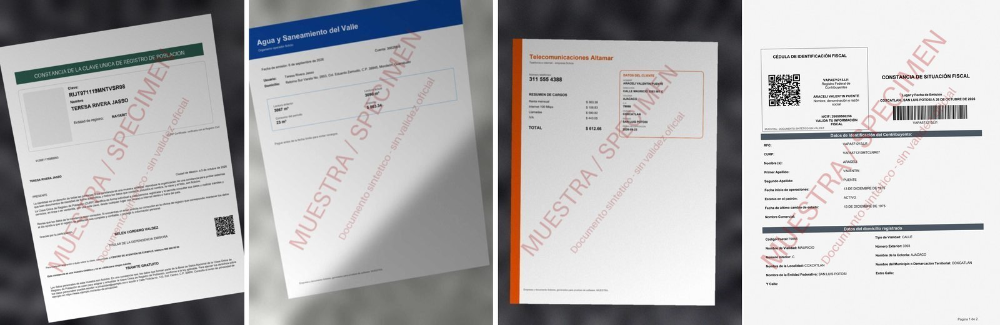

# synth/: generador de documentos sintéticos

Genera personas ficticias, cada una con sus 4 documentos coherentes entre sí: CURP, INE, Constancia de Situación Fiscal y comprobante de domicilio. Cada persona sale con su ground truth.



```bash
make sepomex         # una vez: el generador toma los domicilios del catálogo de SEPOMEX
make synth           # dataset completo en data/synthetic/ (no se versiona)
make synth-samples   # 4 personas de muestra en data/synthetic/samples/ (sí se versionan)

uv run python -m synth --train 20 --val 5 --test 5 --out /tmp/prueba   # dataset chico
uv run python -m synth --resume      # continúa una generación interrumpida
```

Por defecto usa la mitad de los núcleos (`--workers N` para cambiarlo).

Si la generación se interrumpe (por ejemplo, por un apagado inesperado), `--resume` la continúa con la misma configuración, guardada en `generacion.json`. Conserva solo las personas completas. Se considera completa una persona cuyo `ground_truth.json` es válido y cuyos PDF y JPG terminan como deben. Las incompletas o dañadas se regeneran: un apagado puede dejar truncados o en ceros archivos que parecían escritos.

La configuración está en [`config.toml`](config.toml): semilla, personas por split, tasas de casos límite, diseños de comprobante y probabilidad de cada modalidad. Lo que no esté en el TOML toma el valor por defecto de [`config.py`](config.py).

## Qué genera

**Personas** ([`persona.py`](persona.py)):

- La CURP y el RFC se calculan con `build_curp` y `build_rfc` (fase 2) a partir de nombre y fecha. Los nombres de pila salen de listas propias por género (los de Faker `es_MX` no respetan el género), y los apellidos y las calles salen de Faker. El domicilio es un asentamiento real del catálogo de SEPOMEX, con calle y número inventados.
- Casos límite con tasa configurable: nombres compuestos, JOSÉ y MARÍA, partículas (DE LA, DEL), Ñ, Ü, sin apellido materno, sexo X, nacidos en el extranjero (NE), número interior y S/N. Las personas tienen entre 18 y 70 años, y la mitad de los domicilios está en Nayarit.

**Documentos** ([`render/`](render/)): plantillas **inspiradas, no réplicas**.

- Marca de agua "MUESTRA / SPECIMEN" en todas las páginas, dibujada como imagen para que no aparezca en la capa de texto.
- Sin logotipos, escudos, hologramas ni elementos de seguridad. La foto es una silueta. Las empresas son ficticias y los QR traen datos sintéticos.
- Los metadatos del PDF dicen que es un documento sintético.

| Documento | Plantilla | Rasgos |
|---|---|---|
| CURP | `curp_constancia` | Estructura de la constancia real: título como imagen, nombre completo en un renglón, entidad de registro; no imprime sexo, fecha ni entidad de nacimiento ni nacionalidad. Firmante ficticio y QR con datos sintéticos |
| INE | `ine_credencial` | Frente y reverso en una página; domicilio abreviado ("C", "COL", "NAY.") |
| CSF | `csf_constancia` | Estructura de la constancia real, palabras sin caracteres de espacio; domicilio por campos (tipo y nombre de vialidad, localidad, municipio); acentos en la mitad |
| Comprobante | `comprobante_luz`, `_agua`, `_banco` | Tres diseños con estilos de texto, domicilio y fecha distintos |
| Comprobante | `comprobante_telefono` | **Solo en test**, para medir la generalización a un diseño no visto |

**Modalidades** ([`modalities.py`](modalities.py)), elegidas por documento con probabilidades realistas:

| Modalidad | Qué es | Archivos |
|---|---|---|
| `digital` | PDF con capa de texto | `.pdf` |
| `escaneo` | Casi recto, ruido, contraste, a veces en grises | `.pdf` sin texto + `.jpg` |
| `foto` | Perspectiva, rotación, fondo, luz desigual, sombra, desenfoque (también de movimiento), JPEG | `.pdf` sin texto + `.jpg` |

**Inconsistencias:** el 10% de las personas lleva una inconsistencia etiquetada, con la advertencia que debería producir:

- `domicilio_ine_distinto`: la INE trae otro domicilio y debe producir `DOMICILIO_NO_COINCIDE`.
- `comprobante_antiguo`: el comprobante tiene de 100 a 365 días y debe producir `COMPROBANTE_ANTIGUO`.
- `errata_nombre`: una letra cambiada en el apellido de la INE o la CSF; debe producir `NOMBRE_NO_COINCIDE`.

También se registran las advertencias "naturales": `CURP_NACIDO_EN_EXTRANJERO`, y `RFC_NO_COINCIDE_CON_CURP` cuando el SAT y RENAPO forman distinto las letras (por ejemplo, con un solo apellido). `expected_warnings` no pretende ser exhaustiva: lista lo inyectado y lo que se sabe de antemano.

## Salida

```
data/synthetic/
  dataset.json                  semilla, configuración, conteos, SHA-256 de SEPOMEX y versiones
  <split>/manifest.jsonl        un documento por línea
  <split>/<persona_id>/
    ground_truth.json           formulario esperado + verdad por documento
    curp.pdf  ine.pdf  csf.pdf  comprobante.pdf
    *.jpg                       solo en escaneo y foto
```

El esquema está en [`src/docextract/dataset.py`](../src/docextract/dataset.py). Tiene dos niveles de verdad:

- `form`: el formulario como lo guarda la FEA (mayúsculas, sin acentos, con Ñ). Contra esto se evalúa la salida final.
- `documents[].fields`: cada campo **tal como está impreso** en ese documento, con sus acentos, abreviaturas e inconsistencias. Contra esto se evalúa cada extractor.

Los splits son por persona: los documentos de una persona nunca quedan repartidos entre train y test.

## Reproducibilidad

Cada persona tiene su propia semilla, derivada de (semilla global, split, índice). Con la misma semilla, el mismo catálogo y las mismas versiones de las bibliotecas se obtienen **los mismos bytes**, sin importar el orden ni el número de procesos (`--workers`). Una prueba lo comprueba. Los PDFs se generan sin fechas ni identificadores aleatorios (`invariant=1` de reportlab). `dataset.json` registra todo lo necesario para repetir una corrida.

## Privacidad

Las personas son ficticias, pero una CURP o un RFC calculados a partir de un nombre inventado podrían coincidir por azar con los de una persona real. Sin el nombre real asociado no identifican a nadie. Los domicilios usan colonias y CPs reales del catálogo público de SEPOMEX con calles y números inventados. El catálogo en sí no se versiona, porque sus términos no permiten distribuirlo.
